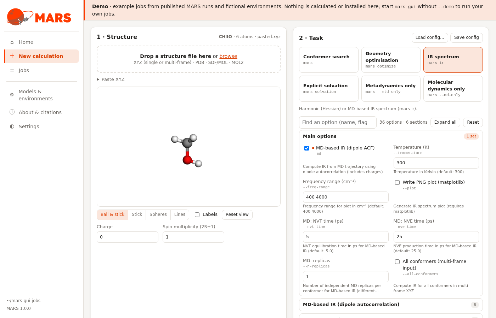
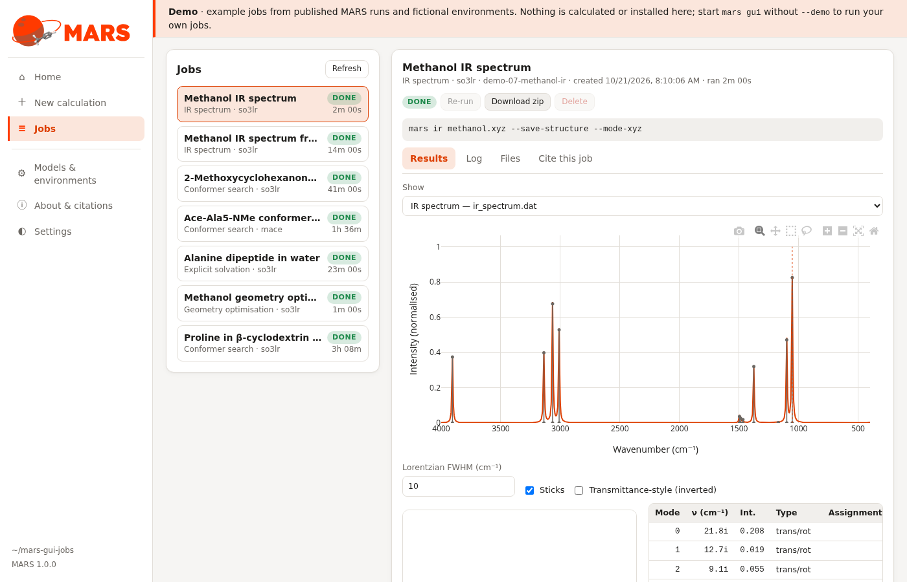
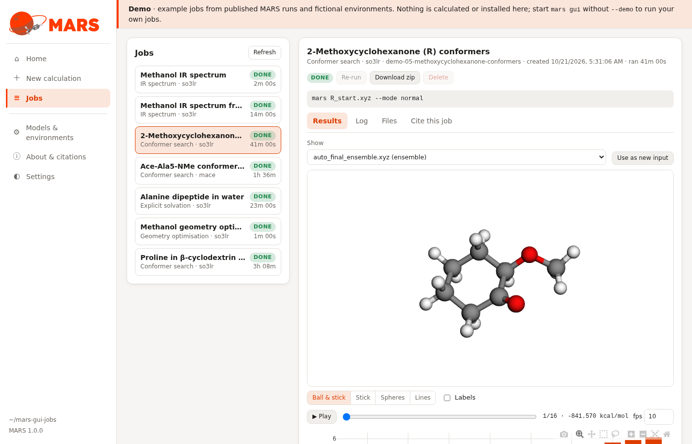
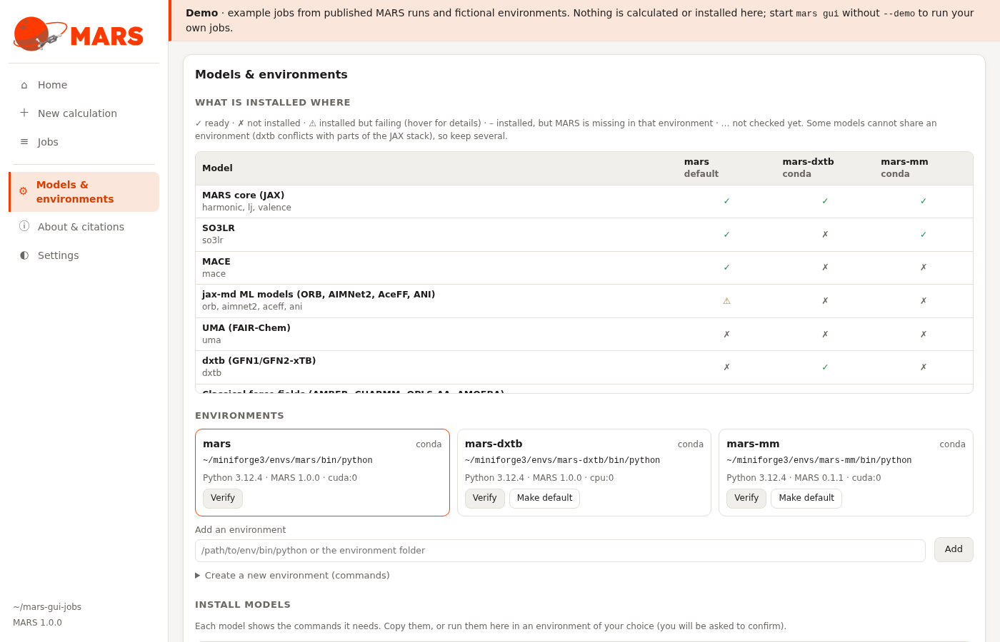
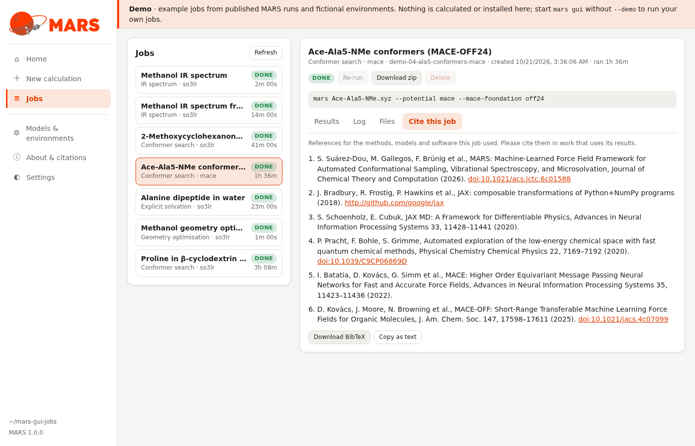

# Graphical interface

The MARS GUI runs every MARS calculation from your web browser: load a
structure, pick a task and a model, follow the run, and look at the
structures, ensembles and spectra it produces. It runs **locally**: a small
server started by `mars gui` on your own machine, nothing is sent anywhere.

```bash
mars gui                      # opens http://127.0.0.1:8765/ in your browser
mars gui --workdir ~/mars-jobs --port 8800 --no-browser
mars gui --install-desktop    # adds a "MARS" launcher to your desktop menu (Linux)
```

<video src="../assets/gui/gui_demo.mp4" poster="../assets/gui/home.png" autoplay loop muted playsinline controls style="width:100%; border-radius:8px; border:1px solid var(--md-default-fg-color--lightest)"></video>

*A tour of `mars gui --demo`.*

!!! tip "Try it without running anything"
    `mars gui --demo` opens the GUI with finished example jobs, built from the
    outputs of published MARS runs (an IR spectrum, conformer ensembles with
    SO3LR and MACE, a host–guest complex in NCI mode, a solvated peptide) and
    fictional environments. Nothing is calculated or installed, so it is a safe
    way to explore the interface. The screenshots on this page come from it.

Every GUI job is an ordinary `mars` command line. It is shown before the job
starts and saved with it, so any calculation set up in the GUI can be repeated
from a terminal or a cluster script.

The settings can also be kept as a [config file](../config/overview.md):
*Save config* downloads them, the *Config file* tab under the form shows the
file live, and every job folder gets a `config.toml` next to `command.sh`.
Run it with `mars <task> --config file.toml`. *Load config…* fills the form
from a config file; options the form cannot hold (for example file names,
which have to be attached again) are listed after loading.

## 1. New calculation



1. **Structure**: drop an XYZ (single or multi-frame), PDB, SDF/MOL or MOL2
   file, or paste XYZ text. Set the charge and spin multiplicity.
2. **Task**: conformer search, geometry optimisation, IR spectrum, explicit
   solvation, metadynamics only or MD only. Every command-line option of the
   task is in the form (see the [User guide](../guide/index.md)): the common
   ones under *Main options*, the rest in collapsible sections named like the
   `--help` groups. The form adapts to your choices: an option appears only
   when it applies (the FIRE parameters with `--method FIRE`, the MD-IR
   settings once *MD-based IR* is ticked, the barostat settings with
   *Barostat*, ...), and hidden options never reach the command. *Find an
   option* searches names, flags and help texts; options that do not apply
   yet are shown greyed with what they need. A dot marks values changed
   from the CLI default, and *Reset* restores them.
3. **Potential**: SO3LR, MACE, UMA, ORB, AIMNet2, AceFF, ANI, dxtb or a
   classical force field, with its own options.
4. **Run settings**: device (GPU / CPU), precision, and the **environment** the
   job runs in. The GUI marks the environments that have the chosen model
   (✓) and picks one for you; *Manage…* opens
   [Models & environments](#3-models-environments).

**Run job** starts it. Several jobs are queued and run one after another
(`--max-parallel` runs more at once).

## 2. Jobs and results





Each job has:

- **Results**: final structures, conformer ensembles with their energies
  (3D view with playback and an energy plot), trajectories, solvation
  clusters, and IR spectra with the mode table and the animated normal modes. *Use as new input* sends a result structure back to
  *New calculation*.
- **Log**: the live log of the run.
- **Files**: every output file, downloadable one by one or as a zip.
- **Cite this job**: the references for the methods and models the job used,
  as text or BibTeX (see below).

*Re-run* repeats a job with the same settings, *Cancel* stops a running one.
A job page has its own address (`#jobs/<id>`), so it can be bookmarked.

## 3. Models & environments



MARS models come from packages that cannot all be installed together (for
example dxtb conflicts with parts of the JAX stack), so it is normal to have
several Python environments. This page shows:

- **What is installed where**: every model family against every environment
  the GUI knows (this GUI's own, every conda environment, and the ones you add
  by path). ✓ ready · ✗ not installed · ⚠ installed but failing (hover for the
  error, e.g. missing model weights) · – installed, but MARS itself is missing
  in that environment.
- **Environments**: Python and MARS versions; **Verify** imports every model
  and lists the GPUs JAX sees; **Make default** sets the environment used when
  a model is available in several.
- **Install models**: for each model, the exact commands (the same as in
  [Installation](../install.md)). **Copy commands** to run them yourself, or
  **Install** to run them in a chosen environment from the GUI, after a
  confirmation that shows every command. Steps that cannot be automated (for
  example accepting the UMA licence and `huggingface-cli login`) are listed.

## 4. Citations



*Cite this job* lists MARS, its numerical libraries and the articles of the
methods and models the job used (for example SO3LR for an SO3LR job, AccFG for
the peak assignment of an IR spectrum, the MACE family you chose). The list is
generated from the same references as the [Citation](../about/citation.md)
page. *About & citations* also credits the software the GUI itself uses
(3Dmol.js for the 3D viewer, Plotly.js for the plots).

## Remote machines and clusters

The server binds to `127.0.0.1` by default: only your own machine can reach
it. On a remote workstation, forward the port over SSH instead of exposing it:

```bash
ssh -L 8765:127.0.0.1:8765 user@workstation   # then, on the workstation: mars gui --no-browser
```

and open `http://127.0.0.1:8765/` locally. For cluster jobs, copy the command
shown on the job page into your batch script.
